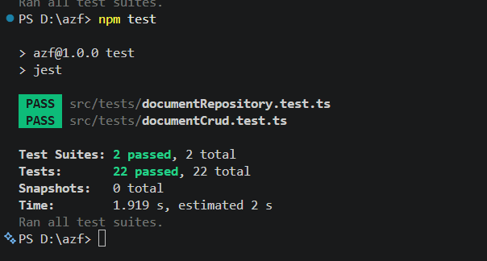
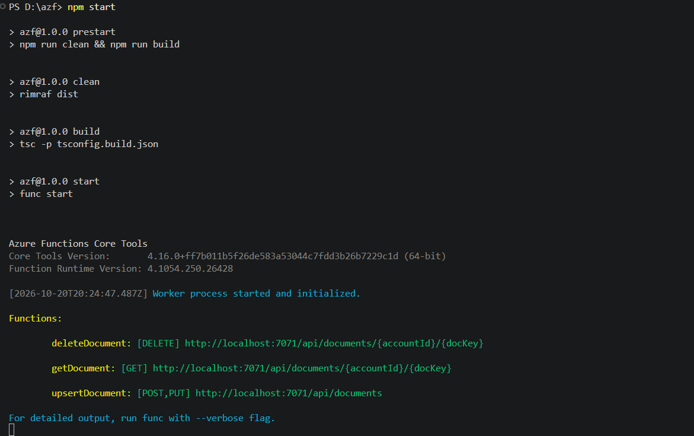

# Azure Functions + Redis CRUD
### Electronic Billing System — Node.js 22 + TypeScript

---

## Table of Contents

1. [Environment Setup (Developer Guide)](#environment-setup-junior-developer-guide)
   - [1.1 Install VS Code](#11-install-vs-code)
   - [1.2 Install VS Code Extensions](#12-install-vs-code-extensions)
   - [1.3 Install Node.js 22](#13-install-nodejs-22)
   - [1.4 Install Azure Functions Core Tools](#14-install-azure-functions-core-tools)
   - [1.5 Install Docker Desktop](#15-install-docker-desktop)
   - [1.6 Install Git](#16-install-git)
2. [Prerequisites Summary](#prerequisites-summary)
3. [Project Structure](#project-structure)
4. [Local Setup](#local-setup)
5. [Environment Variables](#environment-variables)
6. [Running the Application](#running-the-application)
7. [Running Unit Tests](#running-unit-tests)
8. [API Reference](#api-reference)
   - [POST /api/documents](#1-post-apidocuments)
   - [PUT /api/documents](#2-put-apidocuments)
   - [GET /api/documents/{accountId}/{docKey}](#3-get-apidocumentsaccountiddockey)
   - [DELETE /api/documents/{accountId}/{docKey}](#4-delete-apidocumentsaccountiddockey)
9. [Data Model](#data-model)
10. [Error Reference](#error-reference)
11. [Architecture Overview](#architecture-overview)

---

## Environment Setup (Junior Developer Guide)

Follow these steps in order before cloning the project. Each tool is required to run the application locally.

---

### 1.1 Install VS Code

Visual Studio Code is the recommended editor for this project.

> Download: https://code.visualstudio.com/

1. Download the installer for your OS
2. Run the installer and follow the wizard
3. Open VS Code after installation

---

### 1.2 Install VS Code Extensions

Install the following extensions from the VS Code Marketplace. Click each link and press **Install**:

| Extension | Purpose | Link |
|-----------|---------|------|
| Azure Functions | Debug, deploy and manage Azure Functions directly from VS Code | [Install](https://marketplace.visualstudio.com/items?itemName=ms-azuretools.vscode-azurefunctions) |
| Azure Tools | Full Azure services suite (includes Storage, Cosmos DB, etc.) | [Install](https://marketplace.visualstudio.com/items?itemName=ms-vscode.vscode-node-azure-pack) |
| REST Client | Send HTTP requests directly from `.http` files inside VS Code | [Install](https://marketplace.visualstudio.com/items?itemName=humao.rest-client) |
| ESLint | Real-time TypeScript/JavaScript linting | [Install](https://marketplace.visualstudio.com/items?itemName=dbaeumer.vscode-eslint) |
| Prettier | Automatic code formatting on save | [Install](https://marketplace.visualstudio.com/items?itemName=esbenp.prettier-vscode) |
| Docker | Manage Docker containers and images from VS Code | [Install](https://marketplace.visualstudio.com/items?itemName=ms-azuretools.vscode-docker) |
| GitLens | Enhanced Git history and blame annotations | [Install](https://marketplace.visualstudio.com/items?itemName=eamodio.gitlens) |

**How to install an extension manually:**
1. Open VS Code
2. Press `Ctrl+Shift+X` (Windows/Linux) or `Cmd+Shift+X` (macOS)
3. Search for the extension name
4. Click **Install**

Or install all at once from the terminal:
```bash
code --install-extension ms-azuretools.vscode-azurefunctions
code --install-extension ms-vscode.vscode-node-azure-pack
code --install-extension humao.rest-client
code --install-extension dbaeumer.vscode-eslint
code --install-extension esbenp.prettier-vscode
code --install-extension ms-azuretools.vscode-docker
code --install-extension eamodio.gitlens
```

---

### 1.3 Install Node.js 22

> Download: https://nodejs.org/en/download

1. Select **LTS version 22.x**
2. Run the installer
3. Verify installation:
```bash
node --version   # should print v22.x.x
npm --version    # should print 10.x.x or higher
```

> **Tip:** If you need to manage multiple Node.js versions, use [nvm-windows](https://github.com/coreybutler/nvm-windows/releases) on Windows or [nvm](https://github.com/nvm-sh/nvm) on macOS/Linux.

---

### 1.4 Install Azure Functions Core Tools

This CLI tool runs Azure Functions locally without needing an Azure account.

```bash
npm install -g azure-functions-core-tools@4 --unsafe-perm true
```

Verify installation:
```bash
func --version   # should print 4.x.x
```

> If `func` is not recognized after install, close and reopen your terminal.
> On Windows, you can also install via winget:
> ```bash
> winget install Microsoft.AzureFunctionsCoreTools
> ```

---

### 1.5 Install Docker Desktop

Docker is used to run a local Redis instance without installing Redis directly.

> Download: https://www.docker.com/products/docker-desktop/

1. Download Docker Desktop for your OS
2. Run the installer and follow the wizard
3. Start Docker Desktop
4. Verify installation:
```bash
docker --version   # should print Docker version 24.x or higher
```

Start a local Redis container:
```bash
docker run --name redis-local -p 6379:6379 -d redis
```

Verify Redis is running:
```bash
docker ps   # redis-local should appear in the list
```

> To stop Redis: `docker stop redis-local`
> To restart it later: `docker start redis-local`

---

### 1.6 Install Git

> Download: https://git-scm.com/downloads

1. Run the installer with default options
2. Verify installation:
```bash
git --version   # should print git version 2.x.x
```

---

## Prerequisites Summary

| Tool | Version | Install |
|------|---------|---------|
| VS Code | latest | https://code.visualstudio.com |
| Azure Functions Extension | latest | [Marketplace](https://marketplace.visualstudio.com/items?itemName=ms-azuretools.vscode-azurefunctions) |
| Node.js | 22.x | https://nodejs.org |
| Azure Functions Core Tools | 4.x | `npm install -g azure-functions-core-tools@4` |
| Docker Desktop | 24.x+ | https://www.docker.com/products/docker-desktop |
| Git | 2.x+ | https://git-scm.com/downloads |
| TypeScript | 5.x | included in devDependencies |

---

## Project Structure

```
azf/
├── src/
│   ├── models/
│   │   └── document.ts          # ElectronicDocument interface + domain errors
│   ├── factories/
│   │   └── redisClientFactory.ts # Singleton Redis connection (Factory pattern)
│   ├── repositories/
│   │   └── documentRepository.ts # Redis SET / GET / DEL (Repository pattern)
│   ├── functions/
│   │   ├── documentHandlers.ts  # Pure HTTP handler functions + mapError
│   │   └── documentCrud.ts      # Route registration (app.http)
│   └── index.ts                 # Entry point
├── src/tests/
│   ├── documentRepository.test.ts
│   └── documentCrud.test.ts
├── host.json
├── local.settings.json          # Local env vars (never commit secrets)
├── tsconfig.json                # NodeNext / ES2022 (production)
├── tsconfig.test.json           # CommonJS (Jest)
└── jest.config.js
```

---

## Local Setup

```bash
# 1. Clone and install dependencies
git clone <repo-url>
cd azf
npm install

# 2. Start a local Redis instance (Docker)
docker run --name redis-local -p 6379:6379 -d redis

# 3. Copy and configure environment variables
# Edit local.settings.json with your Redis connection details
```

---

## Environment Variables

Configure these in `local.settings.json` for local development.
In Azure, set them as **Application Settings** in the Function App.

| Variable | Default | Description |
|----------|---------|-------------|
| `REDIS_HOST` | `127.0.0.1` | Redis server hostname or Azure Cache endpoint |
| `REDIS_PORT` | `6379` | Redis server port |
| `REDIS_PASSWORD` | _(empty)_ | Redis access key. Use Azure Key Vault reference in production |
| `REDIS_TLS` | `false` | Set `true` to enable TLS (required for Azure Cache for Redis) |
| `REDIS_TTL_SECONDS` | `0` | Key expiration in seconds. `0` = no expiration |

**Example `local.settings.json`:**
```json
{
  "IsEncrypted": false,
  "Values": {
    "AzureWebJobsStorage": "UseDevelopmentStorage=true",
    "FUNCTIONS_WORKER_RUNTIME": "node",
    "REDIS_HOST": "127.0.0.1",
    "REDIS_PORT": "6379",
    "REDIS_PASSWORD": "",
    "REDIS_TLS": "false",
    "REDIS_TTL_SECONDS": "86400"
  }
}
```

---

## Running the Application

### Option A — Local (without Docker)

```bash
# Build TypeScript and start the Azure Functions runtime
npm start
```

This runs `rimraf dist` → `tsc` → `tsc-alias` → `func start` in sequence.

### Option B — Docker Compose (recommended)

Runs both the Azure Functions app and Redis in isolated containers. No local Node.js or Redis installation required beyond Docker.

```bash
# Build image and start all services (app + Redis)
npm run docker:up

# Stop and remove containers
npm run docker:down

# Stream logs from the functions container
npm run docker:logs
```

Or use Docker Compose directly:

```bash
docker compose up --build    # first run
docker compose up            # subsequent runs (no rebuild)
docker compose down          # stop everything
```

Expected output:
```
Azure Functions Core Tools
Core Tools Version: 4.x.x

Functions:
  getDocument:      [GET]    http://localhost:7071/api/documents/{accountId}/{docKey}
  upsertDocument:   [POST,PUT] http://localhost:7071/api/documents
  deleteDocument:   [DELETE] http://localhost:7071/api/documents/{accountId}/{docKey}
```

> **Auth Level:** All endpoints use `authLevel: 'function'`. For local testing, no key is required.
> In Azure, append `?code=<function-key>` to every request or pass it as `x-functions-key` header.

---

## Running Unit Tests

```bash
# Run all tests once
npm test

# Run tests in watch mode (re-runs on file save)
npm run test:watch

# Run with detailed per-test output
npm run test:verbose

# Run with code coverage report
npm run test:coverage
```

**Expected output:**
```
PASS src/tests/documentRepository.test.ts
PASS src/tests/documentCrud.test.ts

Test Suites: 2 passed, 2 total
Tests:       22 passed, 22 total
```

> Tests use **Jest mocks only** — no real Redis connection is required to run the test suite.

---

## API Reference

Base URL (local): `http://localhost:7071/api`

---

### 1. POST /api/documents

Creates a new electronic document in Redis.

**Route:** `POST /api/documents`  
**Auth:** `x-functions-key: <key>` _(not required locally)_  
**Content-Type:** `application/json`

#### Request Body

```json
{
  "accountId": "tenant-01",
  "docKey": "INV-2024-001",
  "documentType": "INVOICE",
  "issueDate": "2024-01-15",
  "customerTaxId": "20123456789",
  "totalAmount": 1500.00,
  "currency": "PEN",
  "status": "ISSUED",
  "payload": {
    "serie": "F001",
    "correlativo": "00000001",
    "xml": "<Invoice>...</Invoice>"
  }
}
```

#### cURL Example

```bash
curl -X POST http://localhost:7071/api/documents \
  -H "Content-Type: application/json" \
  -d '{
    "accountId": "tenant-01",
    "docKey": "INV-2024-001",
    "documentType": "INVOICE",
    "issueDate": "2024-01-15",
    "customerTaxId": "20123456789",
    "totalAmount": 1500.00,
    "currency": "PEN",
    "status": "ISSUED",
    "payload": { "serie": "F001", "correlativo": "00000001" }
  }'
```

#### Responses

**201 Created** — Document saved successfully
```json
{
  "message": "Comprobante guardado exitosamente."
}
```

**400 Bad Request** — Missing required fields
```json
{
  "error": "Datos incompletos: accountId, docKey y totalAmount son obligatorios."
}
```

**400 Bad Request** — Invalid JSON body
```json
{
  "error": "El cuerpo de la solicitud no es un JSON válido."
}
```

**500 Internal Server Error** — Unexpected error
```json
{
  "error": "Error interno del servidor."
}
```

---

### 2. PUT /api/documents

Updates an existing document. Uses the same route and body as POST.
If the key does not exist, it will be created (upsert behavior).

**Route:** `PUT /api/documents`  
**Content-Type:** `application/json`

#### cURL Example

```bash
curl -X PUT http://localhost:7071/api/documents \
  -H "Content-Type: application/json" \
  -d '{
    "accountId": "tenant-01",
    "docKey": "INV-2024-001",
    "documentType": "INVOICE",
    "issueDate": "2024-01-15",
    "customerTaxId": "20123456789",
    "totalAmount": 1800.00,
    "currency": "PEN",
    "status": "ISSUED",
    "payload": { "serie": "F001", "correlativo": "00000001" }
  }'
```

#### Responses

Same as [POST /api/documents](#1-post-apidocuments).

> `updatedAt` is automatically refreshed on every PUT. `createdAt` is preserved from the original POST.

---

### 3. GET /api/documents/{accountId}/{docKey}

Retrieves a document from Redis by tenant and document key.

**Route:** `GET /api/documents/{accountId}/{docKey}`

| Path Parameter | Type | Description |
|----------------|------|-------------|
| `accountId` | string | Tenant identifier (e.g. `tenant-01`) |
| `docKey` | string | Document key (e.g. `INV-2024-001`) |

#### cURL Example

```bash
curl -X GET http://localhost:7071/api/documents/tenant-01/INV-2024-001
```

#### Responses

**200 OK** — Document found
```json
{
  "accountId": "tenant-01",
  "docKey": "INV-2024-001",
  "documentType": "INVOICE",
  "issueDate": "2024-01-15",
  "customerTaxId": "20123456789",
  "totalAmount": 1500.00,
  "currency": "PEN",
  "status": "ISSUED",
  "payload": {
    "serie": "F001",
    "correlativo": "00000001"
  },
  "createdAt": "2024-01-15T10:30:00.000Z",
  "updatedAt": "2024-01-15T10:30:00.000Z"
}
```

**400 Bad Request** — Missing path parameters
```json
{
  "error": "Faltan parámetros: accountId y docKey son obligatorios."
}
```

**404 Not Found** — Document does not exist
```json
{
  "error": "Comprobante no encontrado: doc:tenant-01:INV-2024-001"
}
```

**422 Unprocessable Entity** — Corrupted data in Redis
```json
{
  "error": "Error al deserializar el comprobante: doc:tenant-01:INV-2024-001"
}
```

**500 Internal Server Error**
```json
{
  "error": "Error interno del servidor."
}
```

---

### 4. DELETE /api/documents/{accountId}/{docKey}

Removes a document from Redis permanently.

**Route:** `DELETE /api/documents/{accountId}/{docKey}`

| Path Parameter | Type | Description |
|----------------|------|-------------|
| `accountId` | string | Tenant identifier |
| `docKey` | string | Document key to delete |

#### cURL Example

```bash
curl -X DELETE http://localhost:7071/api/documents/tenant-01/INV-2024-001
```

#### Responses

**200 OK** — Document deleted
```json
{
  "message": "Comprobante eliminado con éxito."
}
```

**400 Bad Request** — Missing path parameters
```json
{
  "error": "Faltan parámetros de ruta: accountId y docKey son obligatorios."
}
```

**404 Not Found** — Document does not exist
```json
{
  "error": "Comprobante no encontrado: doc:tenant-01:INV-2024-001"
}
```

**500 Internal Server Error**
```json
{
  "error": "Error interno del servidor."
}
```

---

## Data Model

### ElectronicDocument

| Field | Type | Required | Description |
|-------|------|----------|-------------|
| `accountId` | `string` | ✅ | Tenant identifier. Used as part of the Redis key |
| `docKey` | `string` | ✅ | Unique document identifier within the tenant |
| `documentType` | `'INVOICE' \| 'CREDIT_NOTE' \| 'DEBIT_NOTE'` | ✅ | Type of electronic document |
| `issueDate` | `string` | ✅ | Issue date in `YYYY-MM-DD` format |
| `customerTaxId` | `string` | ✅ | Customer tax identification number |
| `totalAmount` | `number` | ✅ | Total amount of the document |
| `currency` | `string` | ✅ | ISO 4217 currency code (e.g. `PEN`, `USD`) |
| `status` | `'DRAFT' \| 'ISSUED' \| 'CANCELLED'` | ✅ | Current document status |
| `payload` | `Record<string, unknown>` | ✅ | Original XML/JSON document content |
| `createdAt` | `string` | auto | ISO 8601 timestamp. Set on first save |
| `updatedAt` | `string` | auto | ISO 8601 timestamp. Refreshed on every save |

**Redis Key Format:**
```
doc:{accountId}:{docKey}
```
Example: `doc:tenant-01:INV-2024-001`

---

## Error Reference

| HTTP Status | Error Class | Trigger |
|-------------|-------------|---------|
| `400` | — | Missing required fields or invalid JSON body |
| `404` | `NotFoundError` | Key does not exist in Redis |
| `422` | `DeserializationError` | Value in Redis is not valid JSON |
| `500` | — | Unexpected runtime error (Redis timeout, network failure, etc.) |

---

## Architecture Overview

```
HTTP Client
    │
    ▼
Azure Functions v4 (Node.js 22)
    │
    ├── documentCrud.ts       → Route registration (app.http)
    ├── documentHandlers.ts   → HTTP logic + try/catch + mapError()
    │
    ▼
DocumentRepository
    │   save(document)        → Redis SET doc:{accountId}:{docKey}
    │   findByKey(id, key)    → Redis GET doc:{accountId}:{docKey}
    │   delete(id, key)       → Redis DEL doc:{accountId}:{docKey}
    │
    ▼
RedisClientFactory (Singleton)
    │
    ▼
Azure Cache for Redis / Local Redis
```

**Design Patterns used:**
- **Factory** — `RedisClientFactory` ensures a single TCP connection is reused across all warm invocations
- **Repository** — `DocumentRepository` isolates all Redis commands from business logic
- **Separation of concerns** — handlers, routes, repository, and model are in separate files



